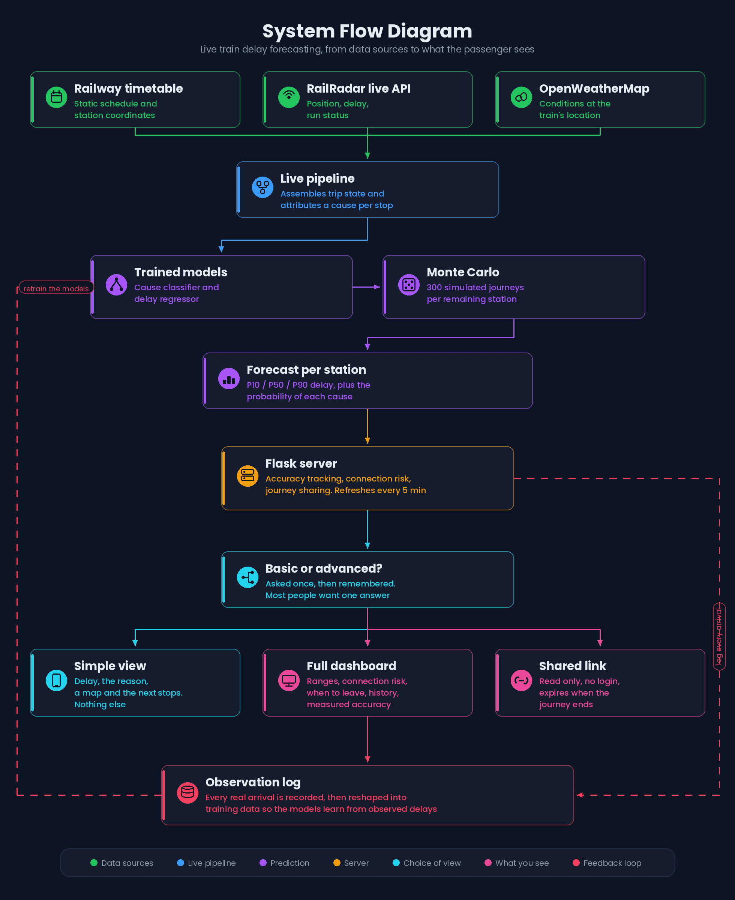

# RailReason

Live Indian Railways tracking that explains **why** a train is late, and gives an honest arrival **range** instead of a single confident time.



---

## What it does differently

Every tracking app shows a delay figure. This one adds three things.

**It explains the cause.** For stations already passed, it compares actual arrival and departure against the timetable and works out where the time went: a long halt, a wait outside a junction, a slow section, fog. That is derived from real timings, not predicted.

**It admits uncertainty.** For stations ahead it simulates the rest of the journey 300 times and reports P10 / P50 / P90. You get "likely between 08:32 and 09:26", not a single time presented as fact.

**It answers whether you will make your connection.** Because the 300 simulated arrivals are kept rather than averaged away, it can count how many arrive too late for an onward departure and give a probability. An app holding a single ETA has nothing to count.

It also measures its own accuracy against what actually happened, and records every real arrival to build a dataset it can eventually retrain on.

---

## Running it

```bash
git clone <your-repo-url>
cd railreason

python -m venv .venv
source .venv/bin/activate          # Windows: .venv\Scripts\activate
pip install -r requirements.txt

cp .env.example .env               # then add your two API keys
```

Keys are free:
[railradar.in/developers](https://railradar.in/developers) for train data (1,000 requests a month),
[openweathermap.org/api](https://openweathermap.org/api) for weather.

Train the models once, then start the server. **Run every command from the repository root**, not from inside `src/`.

```bash
python src/generator.py        # build the synthetic training set
python src/features.py         # turn it into a feature table
python src/model.py            # train the classifier and regressor
python src/attribution.py      # check the rule engine against ground truth

python src/server.py           # then open http://localhost:5000
```

To track a train not already seeded, type its number into the app, or fetch its timetable first:

```bash
python src/fetch_schedule.py 12951
```

### Watch the budget

RailRadar's free tier is 1,000 requests a month. Each tracked train costs roughly two to three calls per refresh cycle, so ten trains at a five minute interval will exhaust a month's quota in about a day. Raise `REFRESH_INTERVAL_SECONDS` in `src/server.py` for long unattended runs, and stop the server when you are not using it.

---

## Layout

```
data/     train timetables, one CSV per train, fetched from RailRadar
docs/     architecture notes and the system diagram
output/   generated: models, datasets, observation log, accuracy log  (gitignored)
src/      all application code
```

### The code, by role

| Area | Files |
|---|---|
| Live data | `railradar_client.py` · `fetch_schedule.py` · `weather_client.py` · `station_conflict.py` |
| Explanation | `attribution.py` |
| Forecasting | `forecast_engine.py` · `model.py` · `features.py` · `generator.py` |
| Serving | `server.py` · `live_pipeline.py` · `dashboard_template.py` · `basic_template.py` |
| Passenger features | `connection_risk.py` · `journey_share.py` · `history.py` · `stretch_risk.py` |
| Measuring ourselves | `accuracy_tracker.py` · `analyse_calibration.py` · `observation_log.py` · `build_real_dataset.py` · `diagnose_accuracy.py` |
| Experiments, not in the running system | `lstm_model.py` · `network_generator.py` · `benchmark_network_features.py` · `calibrate_network.py` · `train_network_model.py` |

---

## Measured results

The cause classifier beats a class-frequency baseline on both probabilistic metrics:

| | model | baseline |
|---|---|---|
| Log loss | **1.39** | 1.57 |
| Brier score | **0.69** | 0.74 |

Plain accuracy is not the headline, because the model's real output is a probability distribution and several causes are close to random even in reality. An early version scored *worse* than baseline until we found `class_weight="balanced"` was destroying calibration; removing it improved log loss, Brier and accuracy at the same time.

The rule-based attribution engine reaches **72.9%** on legs where a real cause occurred. Its main confusion, crossing wait against section slowdown, is a genuine ambiguity: both look identical in timing data without access to signalling.

### Calibration, corrected from evidence

The accuracy tracker found only 55% of arrivals landing inside a range that promises 80%. The correction factor was computed from the logged errors rather than guessed, applied, and coverage moved to **83%**.

That is the one number in this project that was fixed by measurement rather than judgement.

---

## Honest limitations

**The models are trained on synthetic data.** Real historical Indian Railways delay records are not publicly available, so `generator.py` simulates them. Live position, weather and junction data are entirely real; the prediction layer is a sound architecture applied to real inputs but has not been validated against real history. `observation_log.py` is accumulating real arrivals so this can eventually be fixed.

**"Live" means "as of the last check".** The app polls every five minutes, but the data is only as fresh as RailRadar's own pipeline. We cross-checked against NTES and found RailRadar lagging on occasion. Every tracking system has this, including the official one.

**The map draws straight lines** between stations rather than the real track. The marker popup shows the underlying telemetry percentage so the placement can be checked rather than trusted.

**A deeper model did not help.** An LSTM reading the full journey history tied the random forest within 0.003 log loss. Several other configurations landed in the same place. The limit is the data, not the model capacity, which is why the effort went into collecting real observations instead.

**Cross-train features are not deployed.** Adding simulated track occupancy improved crossing-wait recall sharply, but in production `occupants_ahead = 0` would usually mean "we did not look" rather than "the section is clear", and the model cannot tell those apart. The work is in the repo; it is deliberately not switched on.

---

## Data you cannot regenerate

`output/` is gitignored because everything in it can be rebuilt by re-running the scripts, with two exceptions:

- `output/observations.jsonl` — every real arrival ever recorded
- `output/prediction_accuracy_log.jsonl` — every forecast scored against reality

Both describe moments that have passed and cannot be recreated. Back them up outside the repository.
