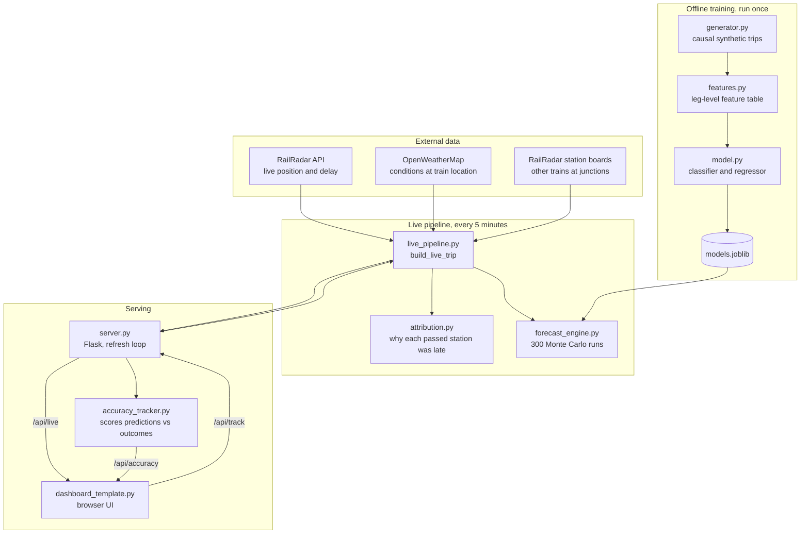
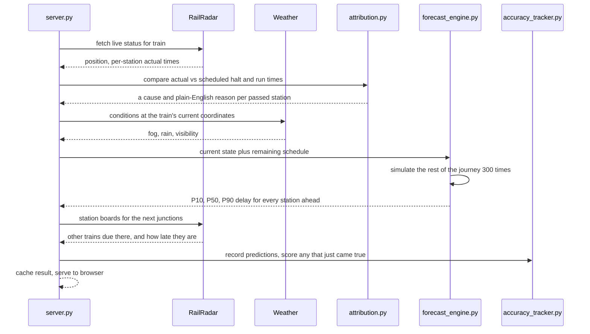

# Live Railway ETA and Delay Explainer

A real-time train tracking system that does two things existing apps don't: it explains **why** a train is late, and it gives an **honest range** instead of a single confident arrival time.

---

## The problem

Open any train tracking app and you'll see "45 minutes late". You won't see why. Was it fog? Was it held at a junction for a faster train? Did it start late and never recover? The cause matters — a train held for crossing may make the time back on the next stretch, while a train losing time to fog probably won't.

The second problem is false confidence. These apps show a single arrival time as though it were a fact. It isn't; it's a forecast, and forecasts have uncertainty. Presenting one number hides that.

## What we built

Three layers, each answering a different question.

| Layer | Question | Method | Certainty |
|---|---|---|---|
| Live data | Where is it now? | RailRadar API, OpenWeatherMap | Observed fact |
| Attribution | Why is it late? | Deterministic rule engine on real timings | High, for stations already passed |
| Forecast | What happens next? | ML classifier + Monte Carlo simulation | Probabilistic, shown as a range |

The split is deliberate. We use rules where the answer is knowable and machine learning only where the problem is genuinely uncertain — not ML everywhere for its own sake.

---

## System workflow



### What happens on a single refresh



---

## How each layer works

### Layer 1 — Live data

`railradar_client.py` calls RailRadar's REST API for live status. `fetch_schedule.py` pulls a train's static timetable once and writes `data/route_<number>_schedule.csv`, including station coordinates. This means **any train RailRadar tracks can be added at runtime** by typing its number into the dashboard — no code change, no restart.

`weather_client.py` reads OpenWeatherMap at the train's current coordinates, replacing a season-and-hour guess with an actual reading.

`station_conflict.py` queries RailRadar's station boards for upcoming junctions to find other trains genuinely due there at the same time, and how late they are.

### Layer 2 — Attribution, the "why"

`attribution.py` takes only what a real feed provides — actual versus scheduled arrival and departure — and infers the cause by comparing where time was lost:

- Time lost **at** a station, beyond its scheduled halt → **halt overrun**
- Time lost **between** stations, approaching a junction → **crossing wait**
- Time lost between stations on open track → **section slowdown**
- Slow running in a fog corridor at night in winter → **fog**
- A large jump with no matching halt or run overrun → **technical fault**
- Time made back → **recovery**

**No machine learning here, on purpose.** These are things we can determine from real timings, so they're stated with confidence rather than as probabilities.

*Measured accuracy: 72.9% on legs where a real cause occurred, 85.7% across all legs.* The main confusion is crossing wait versus section slowdown — a genuine ambiguity, since both look identical in timing data without access to signalling.

### Layer 3 — Forecast, the "what next"

For stations ahead, `forecast_engine.py` runs a **Monte Carlo simulation**:

1. The classifier gives a probability distribution over what might happen on the next leg.
2. The simulation samples one outcome from that distribution, then samples a delay magnitude from the historical distribution for that cause.
3. It repeats through every remaining station — one possible future.
4. It does this **300 times**.
5. The spread of the 300 outcomes becomes the P10 / P50 / P90 range shown in the UI.

Each simulated path carries its own history forward, so a path that just suffered a technical fault becomes more likely to recover time next — mirroring how crews actually behave.

This is why the dashboard says *"likely between 08:51 and 09:54"* rather than *"09:12"*. The uncertainty is the answer, not a caveat on it.

---

## What runs when

### One-time setup
```
python fetch_schedule.py 12951     # per train, writes data/route_12951_schedule.csv
```

### Training, occasionally
```
python generator.py     →  output/synthetic_trips_causal.csv
python features.py      →  output/leg_features.csv
python model.py         →  output/models.joblib
python attribution.py   →  validates the rule engine
```

### Live, during use
```
python server.py        →  http://localhost:5000
```

### Demo without live data
```
python pipeline.py
python build_dashboard.py   →  output/railway_eta_dashboard.html
```

---

## Results, measured

### Cause classifier

Plain accuracy is the wrong headline for a model whose real output is a probability distribution, so we report probabilistic metrics against a class-frequency baseline.

| Metric | Model | Baseline | Reading |
|---|---|---|---|
| Log loss | **1.3915** | 1.5729 | Beats baseline |
| Brier score | **0.6893** | 0.7448 | Beats baseline |
| Top-1 accuracy | 0.441 | — | Reference only |

An early version scored *worse* than baseline until we found that `class_weight="balanced"` was wrecking calibration by over-predicting rare causes. Removing it improved log loss, Brier **and** accuracy simultaneously (accuracy went 0.31 → 0.44).

### An information ceiling, found twice

We tested whether a sequence model does better. An LSTM reading the full journey history scored log loss 1.3948 against the RandomForest's 1.3915 — a tie. RandomForest, HistGradientBoosting and several configurations all landed within ~0.005 log loss of each other.

**The bottleneck is the data, not the model.** Most causes are near-random in the simulated training data, and no architecture can extract signal that isn't there. This finding drove everything that followed.

### Breaking the ceiling with network information

If the data lacks cross-train information, add it. `network_generator.py` runs all trains on a **shared clock contending for track sections** — a section holds one or two trains, the next must wait, and priority decides who yields. A delayed train holds its section longer, so delay propagates between trains.

On a 10-train network, adding the resulting occupancy features:

| Metric | Without | With |
|---|---|---|
| Log loss | 1.0782 | **1.0682** |
| Macro F1 | 0.199 | **0.335** |
| Crossing-wait recall | 0.000 | **0.981** |

The aggregate barely moves while macro F1 jumps, and the reason is instructive: crossing waits are rare (53 of ~19,000 test cases). The features take that class from unpredictable to reliably caught, but nailing a 0.3%-frequency class doesn't shift an average.

**The defensible claim is narrow:** cross-train occupancy is highly informative *for crossing waits specifically*. It is not a broad accuracy improvement.

---

## Decisions we made against our own work

Three things we built and chose not to ship. Each was a judgement call with a stated reason.

**The LSTM is not in production.** It measured marginally worse than the RandomForest on every metric. Shipping it would have meant a worse model plus a PyTorch dependency, bought only by being able to say "we use an LSTM".

**The network-aware model is not swapped in.** It suffers **train/serve skew**. In training, `occupants_ahead = 0` means "the section is genuinely clear". In production it would mostly mean "we didn't look" — we only query one or two junctions per train because of API budget. The model can't distinguish those, so it would read unknown as clear and systematically under-predict the very thing it was built for. One feature, `yielding_to_priority`, is also unobservable live since RailRadar's board doesn't expose precedence.

**We skipped the GNN.** A graph neural network's premise is reasoning over network state, and we observe one or two junctions per train. An architecture designed around network structure, fed almost no network observations, would hit the same skew harder. The bottleneck was never model sophistication — we demonstrated that twice.

The value of this work is in the finding, not the deployment: we identified the mechanism, measured it, and declined to ship it for a specific reason.

---

## Honest limitations

**Training data is synthetic.** Real historical Indian Railways delay records weren't available, so the model learned from a physics-informed generator. Live position, weather and junction-conflict data are 100% real; the prediction layer is a sound architecture applied to real inputs, not yet validated against real historical outcomes.

**"Real-time" means "as of last check".** The app polls every 5 minutes, but the data is only as fresh as RailRadar's own pipeline. We cross-checked against the official NTES site and found RailRadar lagging on one occasion. Every tracking system has this, including NTES itself, which shows its own "last updated" timestamp.

**The map draws straight lines.** The live marker interpolates between stations along a straight line, not the real curved track. The popup shows the actual telemetry percentage so the placement can be checked rather than trusted.

**Simulator parameters needed calibration.** The first network simulation produced a median end-of-journey delay of 115 minutes — far worse than real services. `calibrate_network.py` sweeps the contention and hazard parameters against realistic punctuality behaviour so results come from plausible settings rather than ones chosen to force an effect.

---

## The one number that isn't simulated

`accuracy_tracker.py` records every prediction and scores it once the train actually arrives, building a genuine measured track record: average error in minutes, and what percentage of outcomes fell inside the stated P10–P90 range. A well-calibrated range should contain the outcome 70–90% of the time, and the panel says directly whether the model is over- or under-confident.

Predictions persist to disk across restarts — necessary because the server is deliberately stopped between sessions to conserve API quota, and a prediction made today is usually settled by an arrival observed tomorrow.

Given everything else rests on a synthetic generator, **this panel is the most defensible evidence in the project**, and it improves the longer the system runs.

---

## File reference

| File | Role |
|---|---|
| `railradar_client.py` | Live train status from RailRadar |
| `fetch_schedule.py` | Pulls a train's timetable and coordinates |
| `weather_client.py` | Real conditions at the train's location |
| `station_conflict.py` | Other trains due at upcoming junctions |
| `attribution.py` | Rule engine: why each passed station was late |
| `forecast_engine.py` | Monte Carlo forecasting, shared by both modes |
| `live_pipeline.py` | Assembles one train's complete live picture |
| `server.py` | Flask server, refresh loop, HTTP API |
| `dashboard_template.py` | Browser UI, shared by live and demo modes |
| `accuracy_tracker.py` | Scores predictions against real outcomes |
| `generator.py` → `features.py` → `model.py` | Training pipeline |
| `pipeline.py`, `build_dashboard.py` | Static demo, no live data needed |
| `network_generator.py`, `calibrate_network.py`, `benchmark_network_features.py`, `train_network_model.py` | Multi-train network experiment |
| `lstm_model.py` | Sequence-model benchmark |
